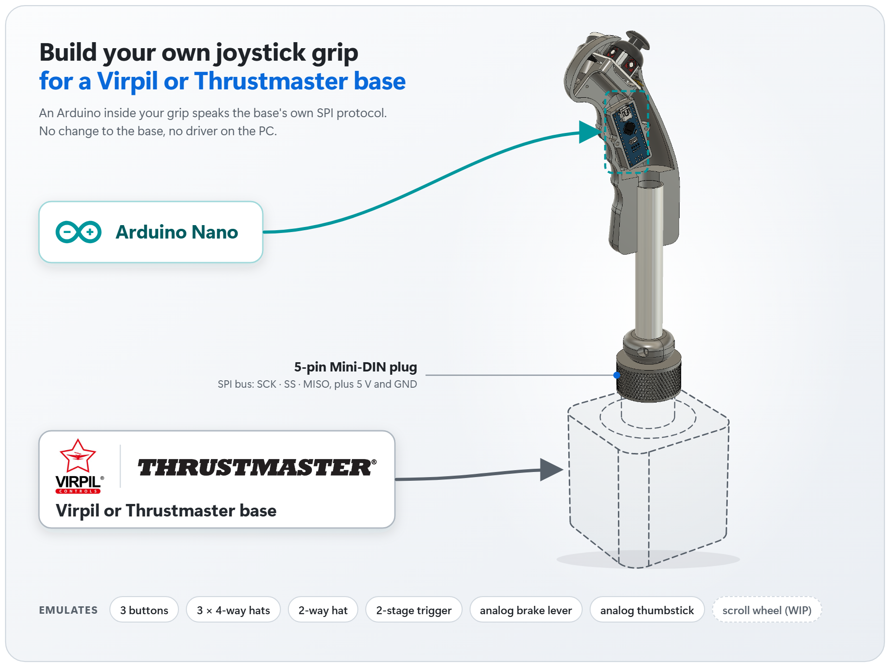
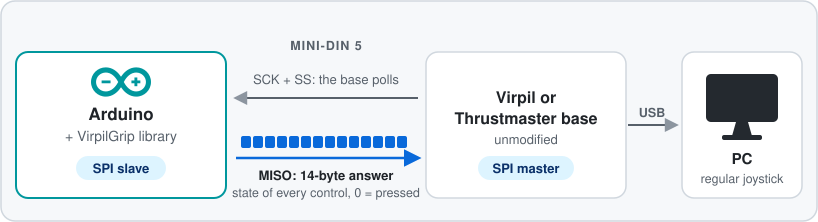
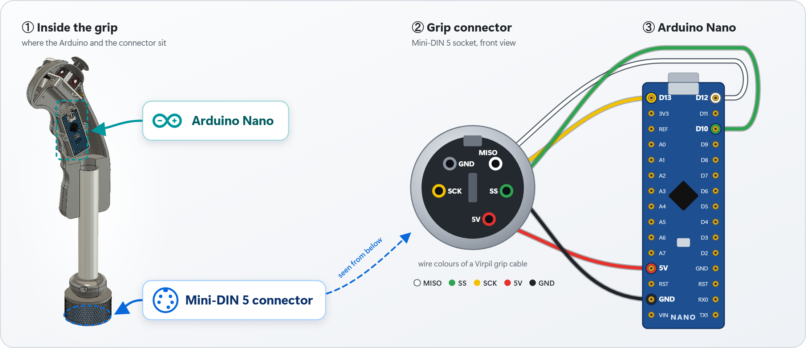

# VirpilGrip

[](https://github.com/p0lysim/VirpilGrip/actions/workflows/compile-examples.yml)
[](https://www.arduino.cc/)
[](LICENSE)

**An Arduino library that makes an Arduino behave like a joystick grip for Virpil and Thrustmaster bases.**
Plug your Arduino into the base instead of the original grip and build your **own custom grip**:
3D-printed shell, any buttons, hats, thumbstick or lever you like. The base still handles USB and the PC
sees a regular joystick; the base simply believes it is talking to a genuine grip.

<p align="center">
  
</p>

---

- [How it works](#how-it-works)
- [Supported controls](#supported-controls)
- [Hardware](#hardware)
- [Installation](#installation)
- [Quick start](#quick-start)
- [Examples](#examples)
- [API overview](#api-overview)
- [Development tools](#development-tools)
- [Troubleshooting](#troubleshooting)
- [Disclaimer](#disclaimer)
- [License](#license)

---

## How it works

<p align="center">
  
</p>

The base polls its grip over SPI through the 5-pin Mini-DIN plug, and the Arduino answers each poll with a 14-byte frame holding the state of every button and axis.
Your sketch only reads its own switches and calls `Set_Button()`, `Set_JoystickValue()`… while the library sends the frame from an interrupt ([protocol](docs/PROTOCOL.md) · [bit map](docs/BITMAP.md)).

## Supported controls

| Control | Count | API | Status |
|---|---|---|---|
| Push buttons | 3 | `Set_Button()` | ✅ |
| 4-way hats with centre push | 3 | `Set_Hat4direction()` | ✅ |
| 2-way hat | 1 | `Set_Hat2direction()` | ✅ |
| Two-stage trigger + safety lever | 1 | `Set_FireButton()` | ✅ |
| Analog brake lever (12-bit) + end-of-travel switch | 1 | `Set_BreakValue()` | ✅ |
| Analog thumbstick (2 × 8-bit) + push | 1 | `Set_JoystickValue()` | ✅ |
| Scroll wheel | 1 | `Set_WheelIncrease()` / `Set_WheelDecrease()` | 🚧 work in progress |

## Hardware

### Supported boards

| Board | MCU | Status |
|---|---|---|
| Arduino **Nano**, Uno, Pro Mini | ATmega328P | ✅ wiring documented, used by the demo grip |
| Arduino Micro, Leonardo, Pro Micro | ATmega32U4 | ⚠️ compiles, wiring not tested yet |
| Mega, ARM, ESP… | — | ❌ not supported (the library uses AVR registers) |

### Wiring

<p align="center">
  
</p>

> ⚠️ Check the voltage of your base with a multimeter before connecting anything.

### Demo grip

To test the library, print the **[demo grip](docs/DEMO_GRIP.md)**: an Arduino Nano, an analog thumbstick and a
push button in a 3D-printed shell, running the [`complete_grip`](examples/complete_grip/complete_grip.ino) example.
STL and STEP files: [`hardware/`](hardware).

## Installation

### Arduino IDE

<a href="https://github.com/p0lysim/VirpilGrip/releases/latest/download/VirpilGrip.zip"></a>

1. Download the ZIP of the latest release with the button above
   (or this repository as a ZIP: **Code → Download ZIP**).
2. In the Arduino IDE: **Sketch → Include Library → Add .ZIP Library…** and select the ZIP.
3. The examples appear under **File → Examples → VirpilGrip**.

Or clone the repository directly into your `Arduino/libraries` folder:

```bash
git clone https://github.com/p0lysim/VirpilGrip.git
```

### PlatformIO

```ini
[env:nano]
platform = atmelavr
board = nanoatmega328
framework = arduino
lib_deps = https://github.com/p0lysim/VirpilGrip.git
```

## Quick start

```cpp
#include <VirpilGrip.h>

VirpilGrip grip;

const int BUTTON_PIN = 2;          // push button between D2 and GND

void setup() {
  pinMode(BUTTON_PIN, INPUT_PULLUP);
  grip.Initialize();               // start answering the base
}

void loop() {
  bool pressed = digitalRead(BUTTON_PIN) == LOW;
  grip.Set_Button(1, pressed);     // shows up as the grip's button 1
}
```

Plug the Arduino into the base and open your base's configuration software (e.g. VPC Configurator) or any
joystick tester: button 1 of the grip lights up while you press your button.

## Examples

| Example | What it shows |
|---|---|
| [`push_button`](examples/push_button/push_button.ino) | Toggles button 1 every second |
| [`hat_button`](examples/hat_button/hat_button.ino) | Rotates hat #1 through UP → RIGHT → DOWN → LEFT |
| [`joystick`](examples/joystick/joystick.ino) | Sweeps the thumbstick X/Y axes |
| [`slider`](examples/slider/slider.ino) | Sweeps the analog brake lever from 0 to 100 % and back |
| [`wheel_button`](examples/wheel_button/wheel_button.ino) | Scroll wheel (work in progress) |
| [`complete_grip`](examples/complete_grip/complete_grip.ino) | A real grip: analog thumbstick on A1/A0, its push on D3, a button on D2 – the [demo grip](docs/DEMO_GRIP.md) firmware |

## API overview

```cpp
grip.Initialize();                                            // once, in setup()
grip.Clear();                                                 // everything back to rest

grip.Set_Button(1, true);                                     // buttons 1..3
grip.Set_Hat4direction(1, false, Direction::UP);              // hats 1..3, click, IDLE/UP/DOWN/LEFT/RIGHT
grip.Set_Hat2direction(1, Direction::DOWN);                   // IDLE/UP/DOWN
grip.Set_FireButton(true, Intensity::SOFT);                   // safety lever up, NONE/SOFT/HARD
grip.Set_BreakValue(42.0);                                    // brake lever, 0..100 %
grip.Set_JoystickValue(Direction::LEFT, Direction::UP,        // thumbstick side for X and Y,
                       30.0, 75.0, false);                    // deflection 0..100 %, push
grip.Set_WheelIncrease();                                     // work in progress

grip.Print();                                                 // dump the 112-bit frame on Serial
```

Complete reference, analog-stick conversion and integration constraints: [docs/API.md](docs/API.md).

## Development tools

- **[`extras/GripReader`](extras/GripReader)** – connect a *genuine* grip to an Arduino and dump its frame on the
  serial monitor (buttons, hats, thumbstick, brake, trigger decoded). This is how the bit map was established, and
  it is the tool to use to map controls that are not supported yet.
- **[`extras/platformio`](extras/platformio)** – a PlatformIO / VS Code project that links the library sources
  of this repository, with a test bench that sweeps an axis and prints the frame.

See [extras/README.md](extras/README.md).

## Troubleshooting

**The base does not react.**
Check SS (D10), SCK (D13) and MISO (D12) and the common ground. Make sure `grip.Initialize()` is called in
`setup()`. Add `Serial.begin(115200);` and call `grip.Print()` in `loop()`: you should see the frame change when
you press your buttons.

**Upload fails on a cheap Nano clone** (`avrdude: ser_open(): can't set com-state`, `not in sync`).
Most clones use a CH340 USB chip and the *old* bootloader: install the CH340 driver and select
**Processor → ATmega328P (Old Bootloader)** in the Arduino IDE (`board = nanoatmega328` in PlatformIO).
See also [this Arduino forum thread](https://forum.arduino.cc/t/avrdude-ser-open-cant-set-com-state-for-com3/1209419/12).

**Compilation error: multiple definition of `__vector_…`.**
Another library (e.g. `SoftwareSerial`) uses the same interrupt vectors as VirpilGrip (`SPI_STC_vect`,
`PCINT0_vect`): the two cannot be used together.

**The on-board LED flickers.** Normal: on a Nano/Uno it is wired to D13, which is the SPI clock.

## Disclaimer

This project is not affiliated with, endorsed by or supported by Virpil Controls or Thrustmaster. Virpil and
Thrustmaster are trademarks of their respective owners. This library is the result of independent reverse
engineering for personal and educational use. Opening or modifying your hardware may void your warranty: you do it
at your own risk.

## License

[GNU General Public License v3.0](LICENSE)
