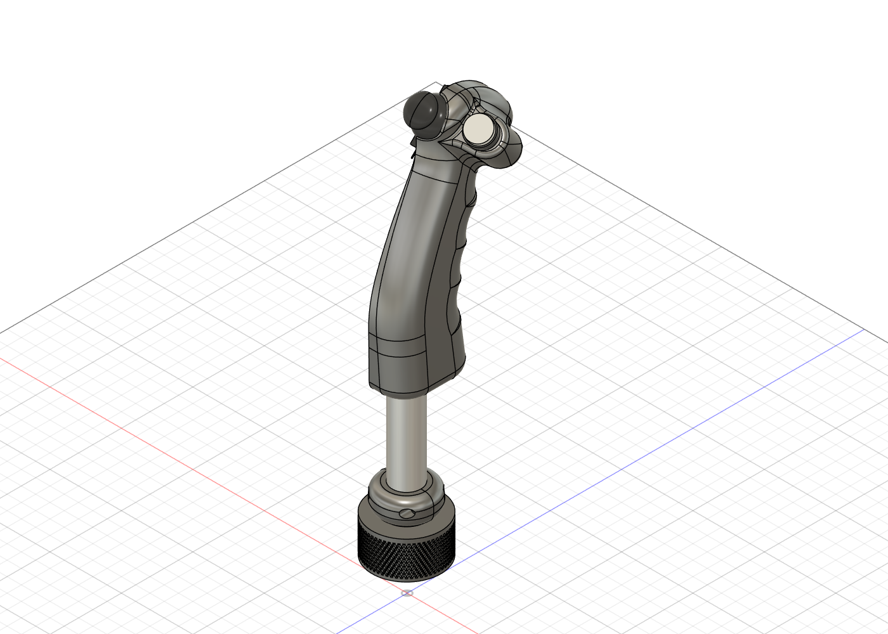
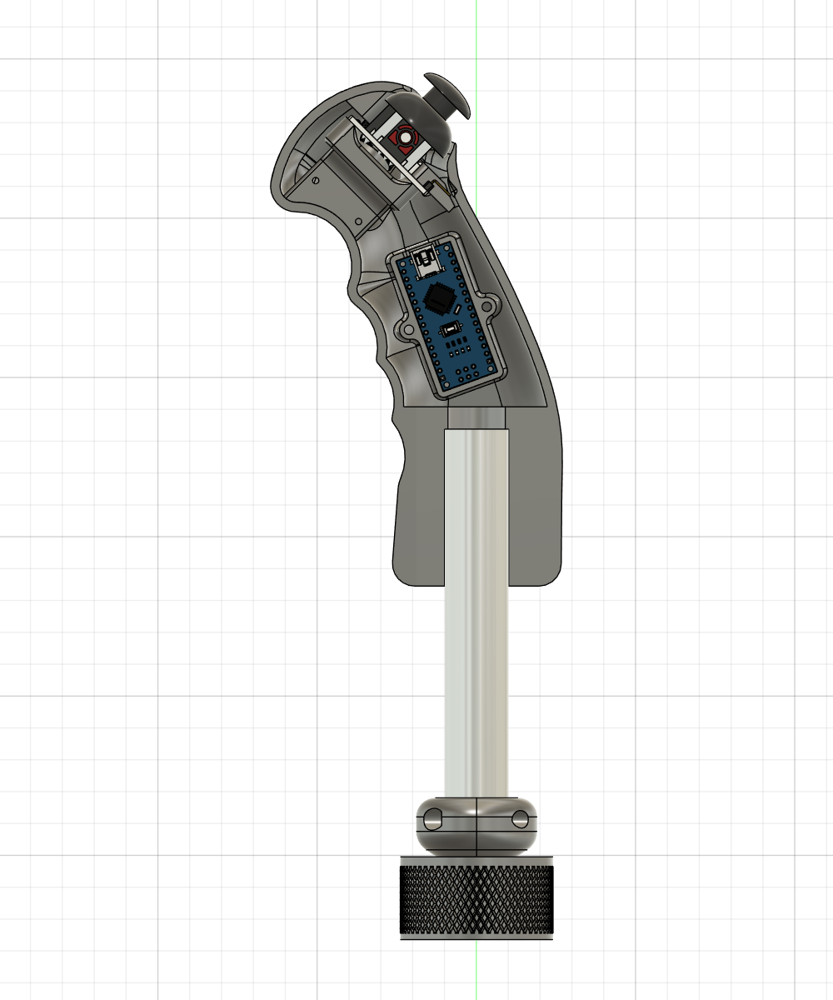
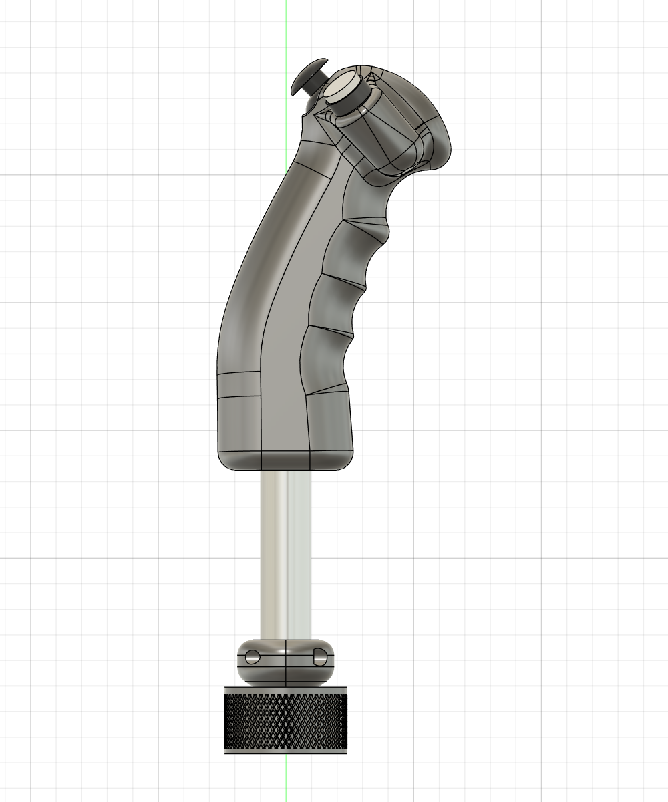

# Demo grip

A 3D-printed grip designed in Fusion 360 to demonstrate the library on a real Virpil base.
The STL and STEP files are in [`extras/demo_grip`](../extras/demo_grip). It runs the [`complete_grip`](../examples/complete_grip/complete_grip.ino) example.

| Outside | Inside (left shell hidden) | Side |
|---|---|---|
|  |  |  |

## Parts

| Part | Description |
|---|---|
| Right / left shells | Two 3D-printed half shells (≈ 38 × 158 × 92 mm each) |
| Tube | Ø 20 mm × 153 mm shaft between the shells and the mount |
| Knurled nut | Ø 48 mm nut that screws onto the Virpil base, like a genuine grip |
| Linkers | Printed parts holding the tube in the nut |
| Reinforcement | Printed part fitted inside the top of the shells |
| Arduino Nano | Housed in the shell, USB port reachable for flashing |
| Analog thumbstick module | 2-axis + push (KY-023 / PS2 type, 34 × 26 mm PCB), top of the grip |
| Push button | Ø 16 mm, thumb side |

Overall size ≈ 63 × 277 × 92 mm.

## Electronics

| Part | Arduino Nano pin |
|---|---|
| Base connector | see [WIRING.md](WIRING.md) (D10, D12, D13, 5V, GND) |
| Thumbstick X | A1 |
| Thumbstick Y | A0 |
| Thumbstick push | D3 (to GND, `INPUT_PULLUP`) |
| Push button | D2 (to GND, `INPUT_PULLUP`) |

The thumbstick and the button are reported to the base as the grip's thumbstick and **button 1**.

## 3D files

Exported from the Fusion 360 model, in [`extras/demo_grip`](../extras/demo_grip) (units: mm):

| File | Content |
|---|---|
| [`STL/`](../extras/demo_grip/STL) | One file per printed part: `shell_right`, `shell_left`, `ring_nut`, `tube`, `linker_left`, `linker_right`, `mount_reinforcement` |
| [`STEP/demo_grip_assembly.step`](../extras/demo_grip/STEP/demo_grip_assembly.step) | Full assembly, with the Arduino Nano, the thumbstick module and the push button |
| [`3MF/`](../extras/demo_grip/3MF) | Ready-to-print projects – coming soon |

The STL files keep their position in the assembly: lay each part flat in your slicer before printing.
