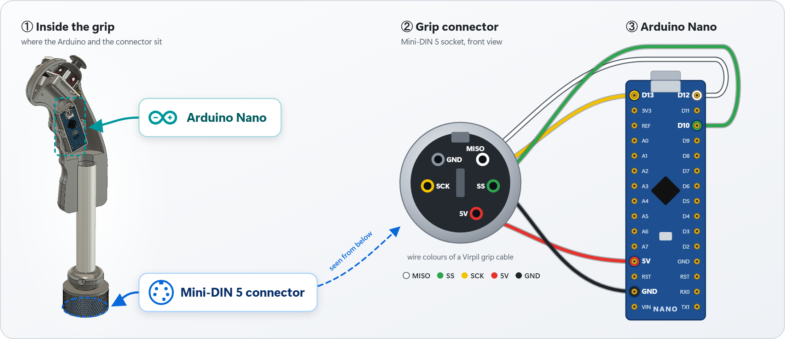
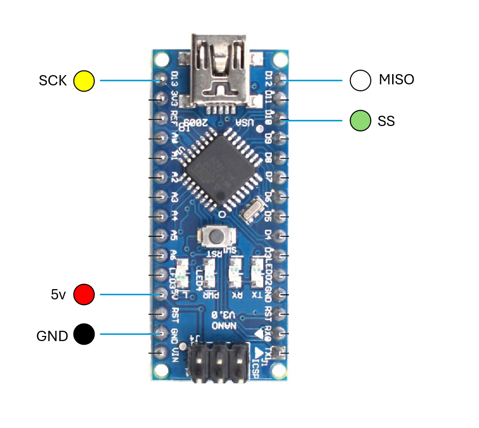
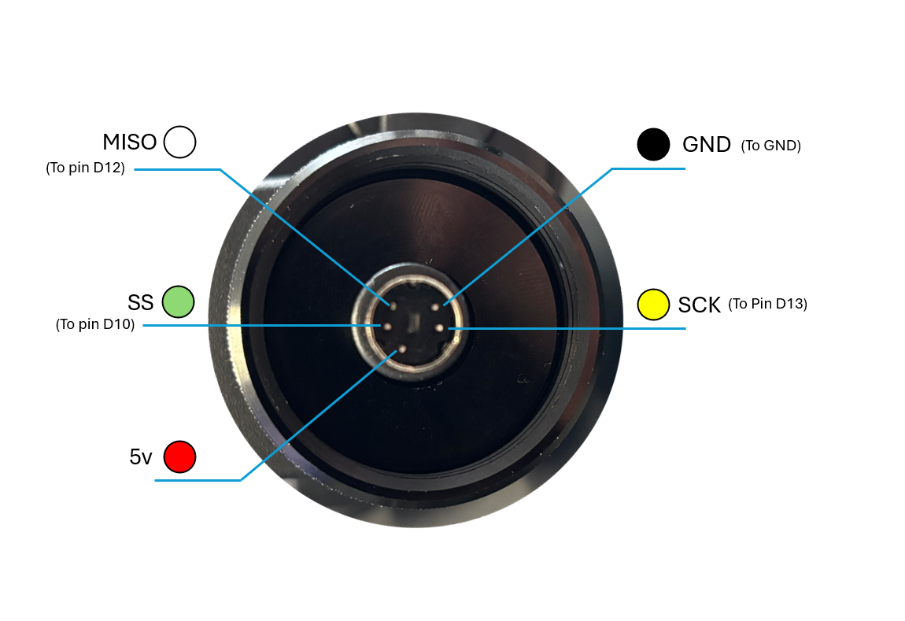

# Wiring

A grip connects to its Virpil or Thrustmaster base through a **5-pin Mini-DIN** connector located in the middle
of the base's locking ring. It carries the grip's power supply and a small **one-way SPI bus**: the base is the
SPI master, the grip is the slave and only ever *talks* (there is no MOSI line).

## Connector pinout

*① the Arduino Nano sits inside the grip, the Mini-DIN 5 connector at the bottom, inside the ring nut ·
② that connector seen from below · ③ where each wire goes on an Arduino Nano.*

| Wire colour (inside a Virpil grip) | Signal | Driven by | Arduino Nano / Uno | Arduino Micro / Leonardo ⚠️ |
|---|---|---|---|---|
| White  | **MISO** – data, grip → base | grip (Arduino output) | **D12** | MISO (PB3 – `MI` pin or ICSP pin 1) |
| Green  | **SS / CS** – chip select, active LOW | base | **D10** | SS (PB0 – D17, shared with the RX LED) |
| Yellow | **SCK** – clock | base | **D13** | SCK (PB1 – `SCK` pin or ICSP pin 3) |
| Red    | **+5 V** – supply from the base | base | **5V** | 5V |
| Black  | **GND** | — | **GND** | GND |

⚠️ ATmega32U4 boards are supported by the code but this wiring has **not been tested yet**.
On a Leonardo, PB0 (SS) is not broken out to a header pin – prefer a Nano, an Uno or a Micro.

### The connector on the base

The mating connector in the middle of the base's locking ring, seen from above:

## Notes and good practice

- **Measure first.** Check the voltage between the red and black pins of your base with a multimeter
  before plugging in an Arduino.
- The grip connector (② above) and the base connector are **mirror images** of each other – always trust
  the *signal name / wire colour*, not the position.
- MOSI (D11 on a Nano/Uno) is not wired, but it is owned by the SPI peripheral in slave mode: do not use it
  for something else. The same goes for D10, D12 and D13.
- The on-board LED of Nano/Uno boards sits on D13 (= SCK) and will flicker while the base polls the grip.
  This is normal.
- While developing you can keep the USB cable plugged in at the same time as the base. A Nano has a diode on
  its USB 5 V line, but the safest way to flash new firmware is still to unplug the base.

## Your own buttons, hats and axes

Everything else is up to you: wire switches, hats, potentiometers or thumbsticks to the free pins of the
Arduino, read them in `loop()` and forward their state with the `Set_*()` functions (see [API.md](API.md)).

The demo grip (see [DEMO_GRIP.md](DEMO_GRIP.md)) uses:

| Part | Arduino pin | Mode |
|---|---|---|
| Thumbstick X axis | A1 | analog |
| Thumbstick Y axis | A0 | analog |
| Thumbstick push   | D3 | `INPUT_PULLUP` (switch to GND) |
| Push button       | D2 | `INPUT_PULLUP` (switch to GND) |

This is exactly the [`complete_grip`](../examples/complete_grip/complete_grip.ino) example.
